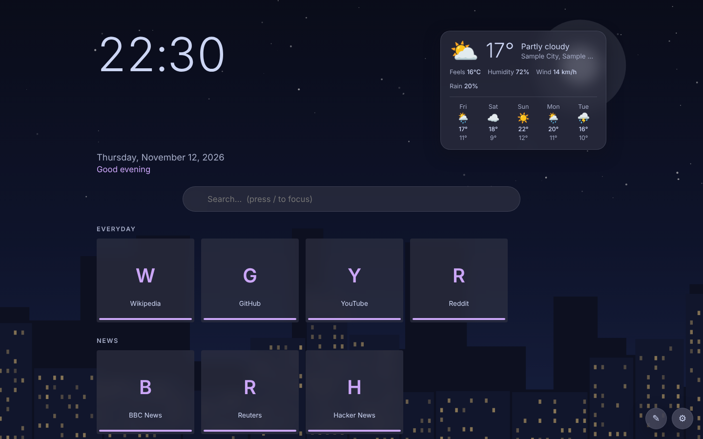

# WeatherTab

A calm, customisable new tab page for **Firefox** and **Chrome** (and Edge / Brave). Live weather, draggable and resizable widgets that snap to a grid, link tiles with searchable icons, Catppuccin / Dracula / Nord themes, animated backgrounds, and city photos that follow your clock. No accounts, no tracking.



- **Website and live demo:** `docs/index.html` (published with GitHub Pages)
- **Downloads:** `docs/downloads/` or the Releases page

## Features
- Live weather and 5-day forecast (Open-Meteo), °C/°F
- Layout editor: move, resize, remove clock, date, greeting, weather, search and links; 12-column snap grid
- Link tiles in groups; icon search (Iconify), upload, tint, resizable tiles and icons
- 10 themes with their own accents: Catppuccin (Latte, Frappé, Macchiato, Mocha), Dracula, Alucard, Nord, Nord Light
- Animated backgrounds: aurora, gradient, stars, rain, snow, fireflies, waves, or match the weather
- City photos by time of day: Tokyo, London, New York, Paris, Sydney, Dubai, Singapore, Auckland (or your own photos)
- Font pairings, backup/restore, themed drop-downs, respects reduced motion

## Install
**Chrome / Edge / Brave:** unzip `weathertab-chrome.zip`, open `chrome://extensions`, enable Developer mode, **Load unpacked**, choose the folder.

**Firefox:** open `about:debugging#/runtime/this-firefox` → **Load Temporary Add-on…** → choose `weathertab-firefox.xpi`. This lasts until Firefox restarts. For a permanent install, have Mozilla sign it (free, "On your own" / unlisted distribution at addons.mozilla.org/developers) or use Developer Edition / Nightly.

## Build from source
```bash
./build.sh
```
Produces `dist/weathertab-firefox-<version>.xpi` and `dist/weathertab-chrome-<version>.zip`, and copies them to `docs/downloads/` for the website. Requires only `bash`, `python3` and `zip`.

```
src/         shared extension code (newtab.html / .css / .js, icon.svg)
manifests/   firefox.json (Manifest V2) and chrome.json (Manifest V3)
assets/      PNG icons for the Chrome build
docs/        GitHub Pages site, demo and downloads
```

The demo (`docs/demo.html`) is the same code with sample weather, bundled into one file. Regenerate the demo and screenshots whenever you change `src/` (see below).

## Updating the site
```bash
python3 tools/build_demo.py     # rebuilds docs/demo.html from src/
python3 tools/screenshots.py    # optional: retakes the screenshots (needs playwright)
./build.sh                      # rebuilds the downloads
```

## Publish the website
1. Push this repository to GitHub.
2. **Settings → Pages → Build and deployment**: Source *Deploy from a branch*, Branch `main`, Folder `/docs`.
3. Your site appears at `https://<your-username>.github.io/<repo-name>/`.

## Releases
Push a tag like `v1.0.0` and the included workflow builds both packages and attaches them to a GitHub Release.

## Privacy
Settings, links and uploaded photos stay in the browser's extension storage. Network requests happen only for the features you use: weather and city search (Open-Meteo), icon search (Iconify), optional city photos (Wikimedia Commons), optional theme fonts (Google Fonts), optional favicons (DuckDuckGo).

## Credits and licences
- Code: MIT (see `LICENSE`).
- City photos load from Wikimedia Commons under each file's own licence; the extension shows a credit link for the photo in use.
- Weather: Open-Meteo. Icons: Iconify. Catppuccin, Dracula and Nord are colour palettes by their respective projects; this project is not affiliated with them.
